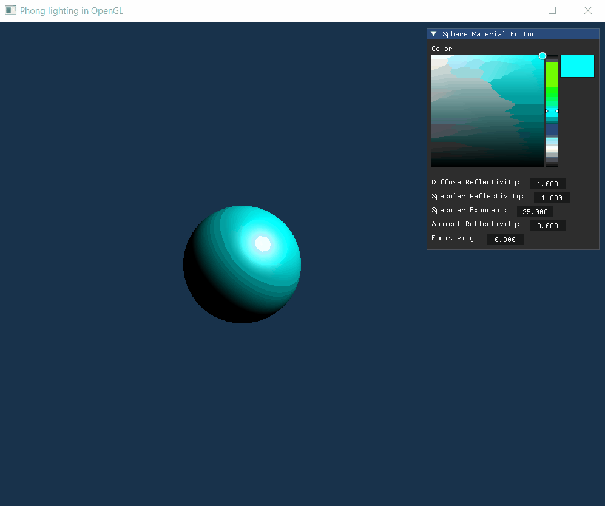

# Phong Lighting Editor in OpenGL

A small interactive editor that visualizes the [Phong reflection model](https://en.wikipedia.org/wiki/Phong_reflection_model) using OpenGL.

The editor features a scene containing a sphere illuminated by a directional light source. You can modify the sphere's material properties in real time to visualize how different parameters of the Phong reflection model affect the appearance of a surface. You can switch between Phong and Gouraud shading and compare how they impact the visuals and performance.

## Demo

## Current Features
- Sphere with adjustable material properties through an editor UI
- Fixed directional light illuminating the sphere
- Movable camera
- [Phong shading](https://en.wikipedia.org/wiki/Phong_shading) (per-fragment lighting)
- [Gouraud shading](https://en.wikipedia.org/wiki/Gouraud_shading) (per-vertex lighting)

## Planned Features
- Positional lights
- Multiple lights
- Customizable light colors
- Importing 3D models from external files

## Technologies Used
- **C++** – Application and rendering logic
- **OpenGL** – Graphics rendering
- **GLFW** – Window creation, OpenGL context creation, and input handling
- **GLAD** – OpenGL function loading
- [**Dear ImGui**](https://github.com/ocornut/imgui) – Interactive editor UI
